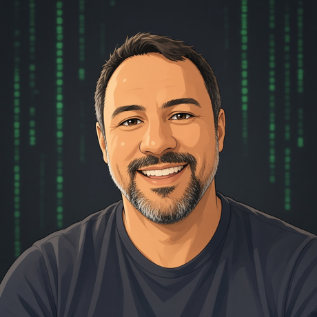

  
  <h1>Hi, I'm Diego Avelar 👋</h1>
  
<b>Senior Backend Engineer</b> · PHP · Go · Python · ~15 years building for the web

  
📍 Santo André, SP, Brazil · 🌎 Open to international remote roles

  
  

---

### About me
I design and build backend systems: APIs, microservices and event-driven architectures. I've spent years taking monoliths apart into well-bounded services, and lately I'm focused on AI-heavy development: GPU inference APIs and tooling that puts LLMs to work.

### 🛠️ Tech stack
**Languages & frameworks**

**Data & messaging**

**Cloud & DevOps**

**Architecture:** Microservices · DDD · CQRS · Event Sourcing

### ✨ Highlights
- **Spassu / TJRJ** (2026–now): Senior PHP Engineer
- **Itaú (via TCS)**: Go microservices
- **Olist** (~5 years): Senior Backend Engineer; helped move a monolith to Go microservices
- **Doc88**: backend development
- Author of [reveng-database](https://github.com/daavelar/reveng-database) ⭐ 20: Artisan commands that reverse-engineer an existing database into Laravel models and seeds

### 🚀 What I'm building
- **AI image inference APIs**: FastAPI services on Modal GPUs, with async jobs (202 + polling/webhook), GPU fallback, models on volumes and output to S3/R2
- **AI video inference API**: image-to-video generation on Modal GPUs
- **Comic-page render API**: turns a JSON story into rendered comic pages and uploads them to S3

### 📊 GitHub stats

  
  

### 📫 Let's talk
Open to senior backend roles, fully remote, with international teams.
[LinkedIn](https://linkedin.com/in/diegoavelar) · [diegoarmando2011@gmail.com](mailto:diegoarmando2011@gmail.com)
